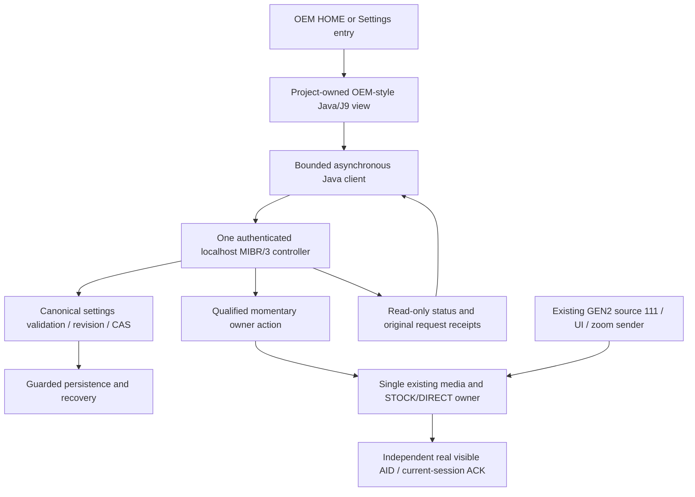

# Native HMI and single-authority control plane — October 2026

**Source update, 23 October 2026:** the real [R48 OEM adapter](../../src/hmi/oem-menu/) and [R46 native controller](../../src/native/mibr-control/) are now supplied with generators, build scripts and host regressions. See [current source/build scope](../build/MU1440_R50_SOURCE.md) for external OEM/J9 inputs and exclusions. The acceptance model below still separates persistence from live effect.

This is a **project-authored design and test-status guide**, not an installation guide or a promise that every control is active. Its reference platform is the exact Škoda `MHI2_ER_SKG13_P4526_MU1440` with the fitted AID10-class cluster. A SEAT/VW port can reuse the approach, but not the exact Java, widget IDs, DSI mappings or media-owner bindings.

## Why a dedicated OEM-style menu

The development UI is accessed through a project-owned HOME / Virtual Cockpit entry, even while wired CarPlay is active. The reference implementation has tested OEM-style `Ssm_5458` PLAIN, VALUE/dropdown and CHECK row semantics, preserving the stock menu lifecycle. A later source-only Java candidate rebinds the original settings scrollbar after selection/viewport restore and prevents unnecessary rebinding on stable snapshots. These build results are not themselves a new physical visual PASS.

### Proposed reference menu (not a universal cross-brand layout)

```text
Virtual Cockpit / CarPlay
  Map presentation                         [choice]
  Arrival time                             [yes/no]
  Speed limit                              [yes/no]
  Compass                                  [yes/no]
  Maneuver information                     [None/Left/Right/Top]
  View                                     [Full/Center/Wide; gated]
  Advanced
    CarPlay in cluster                     [preference, separately gated]
    Frame rate                             [reconnect class]
    Diagnostics                            [read-only]
    Source version                         [reconnect class]
```

The proposed three View presets and their mapping to the fitted cluster's physical overlays are still being qualified. Older negotiated 0/1 indices must not be silently renamed to new 0/1/2 semantics. Physical panel size, coded map plane, advertised ViewArea and nested SafeArea are four distinct quantities. A disabled control must not imply that the feature is already vehicle-ready.

## Architecture and ownership



The diagram distinguishes the existing/host-built blocks from the final target acceptance. A connected Java client does not prove that the target owner, physical AID visible-state source or authenticated role credentials have been qualified. Java never writes profiles directly; the native controller is the only canonical settings authority. It does not create a second iAP2 session, extra MOST writer or another Zoom sender.

### Controller contract (candidate source implementation)

| Operation | Purpose / key boundary |
| --- | --- |
| `HELLO`, `CAPABILITIES` | Version/capability negotiation; unsupported operations must remain visibly disabled |
| `STATUS`, `SNAPSHOT`, `GET` | Current service, revision and independent per-row readback |
| `SET` + `REQUEST_STATUS` | Guarded, idempotently tracked validated persistence; a stored value does **not** prove live application |
| `ACTION` + `ACTION_STATUS` | Momentary owner request and historical receipt, with original request ID and fresh current-session/owner expectations |
| Separate HMI / INPUT roles | Physical KEY40 right-wheel PUSH is not an unrestricted settings editor; the input role cannot mutate arbitrary registry keys |

The versioned native protocol is designed for bounded local, authenticated, request/response exchange. Its current *source* includes one-in-flight route serialization, revision checks, role separation and conservative disabled-by-default capability gates. Missing target owner/focus/ACK must keep route actions unavailable. No raw toggle based only on a source-111 socket or an old snapshot.

## Four independent acceptance layers

| Layer | What a PASS demonstrates | Not demonstrated merely by this layer |
| --- | --- | --- |
| Appearance | HOME tile and menu visible; stock focus, scrolling, Back and re-entry work | Saved settings or stream changes |
| Storage | Validated value survives a recorded native store and revision-consistent readback | Actual iPhone/VC presentation change |
| Application | Qualified owner executes the proper LIVE/PRESENTATION/VIEW/SESSION/RECONNECT pathway | Physically displayed result without confirmation |
| Effect | Same-session/owner/generation outcome and per-key ACTIVE status, with independently visible result where relevant | Future sessions or other vehicle models |

The October 20 reference-unit test showed a **field gap** between UI/store/TEMP and actual navigation presentation. Arrival time, speed limit, compass, maneuver and map options did not demonstrate the desired visible change in that test. This remains open, not a reason to label the entire UI or persistence system untested or to claim it is fully functional.

## OEM steering-wheel boundaries

Right-wheel **rotation** and right-wheel **PUSH/long press** are distinct input families. A passive development zoom observer and the existing GEN2 semantic zoom queue can coexist with untouched original OEM native zoom. The later goal of exclusive zoom routing requires confirmed visible current VC map focus and target-specific OEM behavior. Proposed right-wheel PUSH routing is separately gated behind proof of stock short-press preservation, correct long-press stage and a real route owner ACK; short press, Back, left volume, stock VIEW and unrelated keys remain OEM-owned.

## Source and portability inventory

| Reusable design | Target-specific integration |
| --- | --- |
| Menu layout, semantic controls, state/receipt model, controller protocol concepts, host tests, project-created UI mockups | Exact stock view/JXE, `Ssm_5458` view/widget/resource IDs, OEM CIO entry/bootclasspath lifecycle, J9 ABI and skins |
| Data validation, one canonical registry, fail-closed per-capability admission | Real original DSI listener lifetime, physical AID current route/map-focus signal, qualified existing writer |
| ScreenAlt ViewArea/SAFE-area calibration procedure | Fitted panel, OEM map window, cluster overlays and their actual negotiated geometry |

A SEAT or Volkswagen port should first capture the **original stock menu/cluster behavior read-only**, check firmware/cluster versions and existing add-ons, and build an inert, no-write menu proof. Qualify controller credentials/owner, then visual route behavior, then target-specific rollback. A successful port of another package is useful evidence but is not a byte-for-byte project compatibility certificate.

Original OEM screenshot/skin dumps and private full-mode traces are not included. Only independently created diagrams and this publication summary are supplied here.

See [current integration status](../status/INTEGRATION_STATUS_2026-10-21.md), [module boundaries](MODULE_BOUNDARIES_AND_PORTABILITY.md), and [published source coverage](../status/PUBLISHED_SOURCE_COVERAGE.md).
