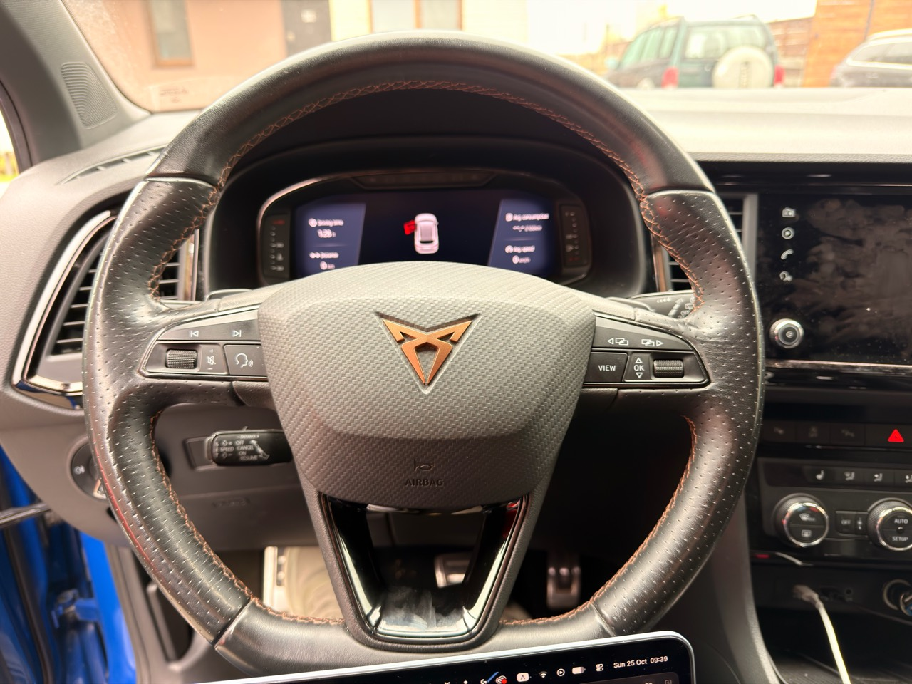
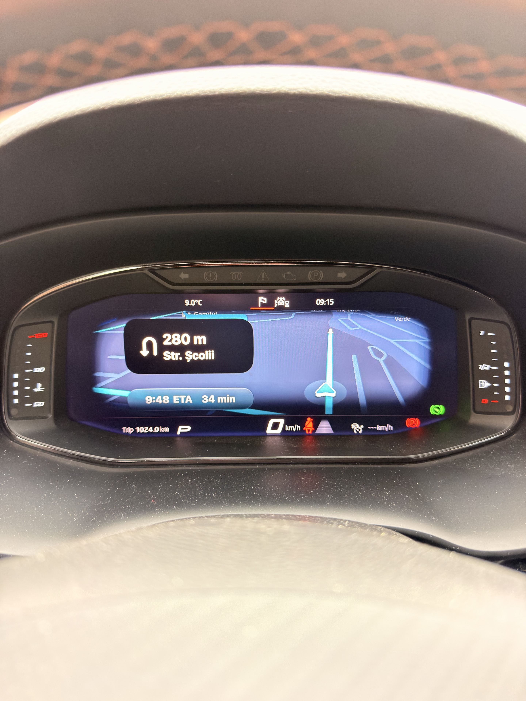
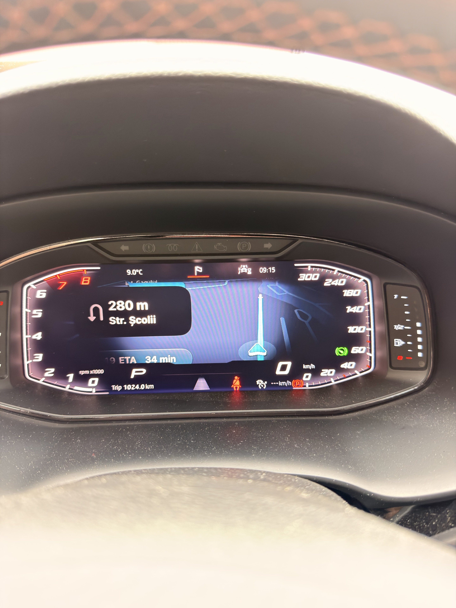
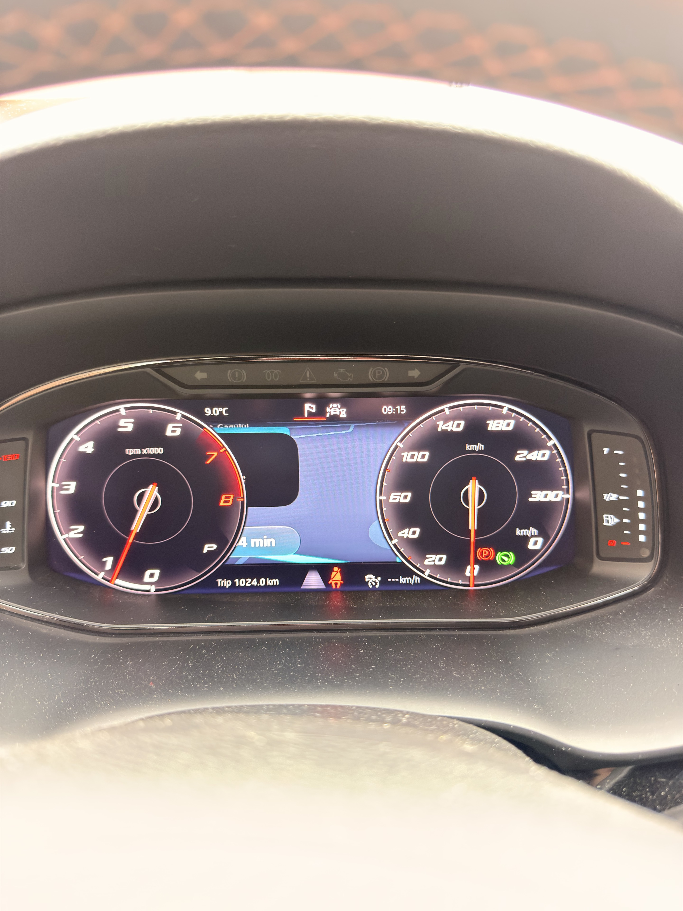
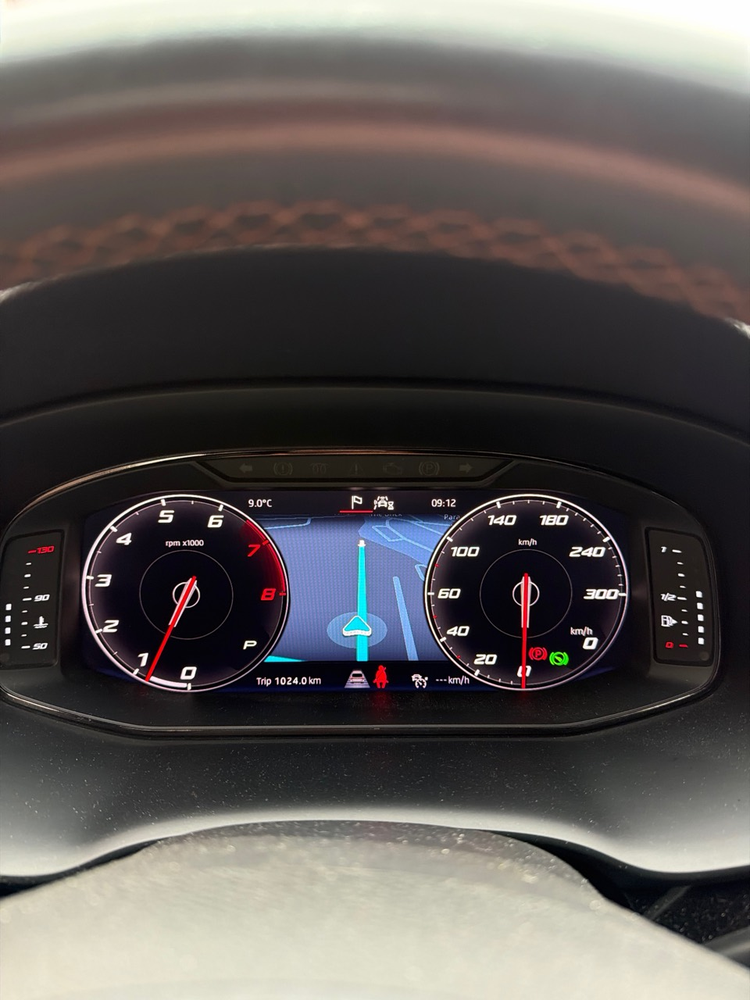
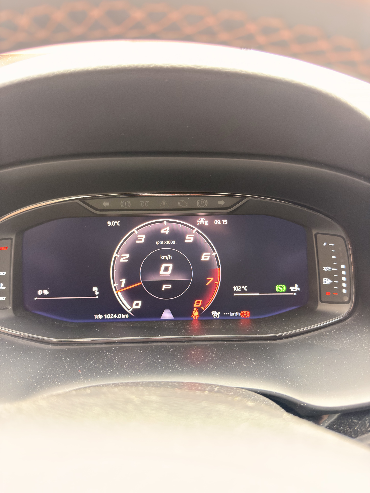

# SEAT/CUPRA Ateca MU1409: observed output and dropdown correction

Observed on 25 October 2026 on one CUPRA Ateca with
`MHI2_ER_SEG11_P4708_1` / MU1409 and a Continental FPK 790-family cockpit.
The tested configuration is a target-adapted project runtime, separate from
the earlier third-party port and from the generic public developer download.
This report does not qualify unchanged MU1440 binaries or a universal SEAT installer.

## Observed behaviour

- Wired CarPlay map output and the native-looking settings menu were observed.
- Arrival-time changes from the menu visibly affected cockpit output.
- Right steering-wheel roller zoom was observed with Apple Maps and Google Maps;
  Waze did not visibly respond to those zoom commands in the contributor's tests.
- Adding `adjacentViewAreas` to the target adapter's `updateViewArea` command
  made preset selection visibly effective. Current public source already sends
  that field; this contribution does not duplicate the native implementation.
- Wide displayed directions and ETA. Full/Center information visibility remains
  unresolved: gauge overlays can obscure cards, and some captures show map only.
  A successful command callback with an empty reply is not visible-effect proof.
- The local menu tree traversal reached 84 widgets and found no native Scrollbar.
  The two attempted local scrollbar bindings did not resolve the issue. Their
  code is not proposed here as a working fix; further scrollbar work is paused.

## Geometry used in the target adapter

All presets retained an outer video canvas of **1010 x 376**. This is the
negotiated video canvas, not a measurement of the physical cockpit panel.

| Preset | SafeArea width x height | Origin x,y | Observation |
| --- | --- | --- | --- |
| Wide | 708 x 244 | 151,56 | Directions and ETA visible in the wide cockpit layout |
| Full | 482 x 244 | 264,56 | Information visibility not qualified across gauge layouts |
| Center | 256 x 244 | 377,56 | Map visible; complete directions/ETA placement not qualified |

These are calibration candidates for the fitted cockpit. SafeArea constrains
important UI placement; it does not introduce black padding or resize the whole
video. The active path forwards compressed H.264 without software decode/resize/
re-encode. Gauge layouts are selected independently through OEM controls; no
automatic layout-following claim is made.

## Dropdown correction in this contribution

The closed native DropDown measured 334 x 6 while its hidden option list was
334 x 471. Subtracting their heights produced negative frame chrome (-465),
triggered `MIBR_SSM_OPTION_VIEW_BOUNDS`, and prevented View choices from opening.
The correction derives vertical frame chrome from runtime LayoutAttribs top/
bottom insets and bounds visible rows within the view. The target-adapted fix
allowed selections to open and reach native View requests on the vehicle.

The public-source integration is built/tested separately; MU1440 vehicle
rendering of this change has not been tested. Existing OEM navigation,
controller references, fonts, selection and close/restore behaviour are retained.

## Photographs

The captions describe visible content, not an inferred active ViewArea index.
Photos alone cannot prove packet geometry, current-session phone acknowledgement,
ownership exclusivity, or recovery reliability.

### Hardware and controls

Vehicle/steering-wheel context, including the right-hand roller. This photograph
does not demonstrate map output or a control mapping by itself.

### Wide map with directions and ETA visible

The maneuver card and ETA/duration bar are both readable in the map region.

### Edge gauges with partly obscured information

Directions and duration are present, but the left side of the information is
obscured. This is not a successful full-information acceptance result.

### Round dials with cards behind the gauges

Fragments of the maneuver and duration cards remain visible behind/alongside
the left dial. This supports an occlusion problem for this photographed state;
it does not establish the cause of every missing-card observation.

### Round dials with center map only

The map/position marker is visible between the large dials; directions and ETA
are not visible. This remains an unresolved layout result.

### Other OEM cockpit layout

Single central dial with no map visible. Included to document the fitted
cockpit's different layouts, not as proof of stock restoration or runtime failure.

## Remaining acceptance work

Qualify directions/ETA placement in reduced layouts and observe Back, focus,
scrolling and re-entry independently. Keep native command acknowledgement,
stored/requested values and visible output separate. No new vehicle installer,
firmware files, recovered OEM Java, private handoff archive or raw input capture
is included in this contribution.
